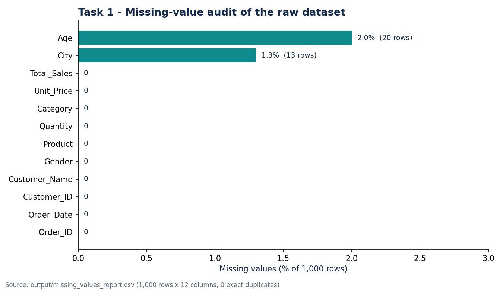
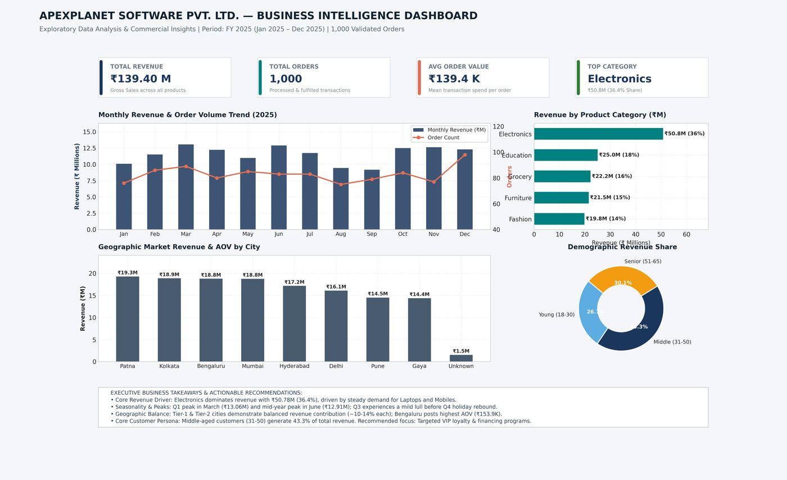
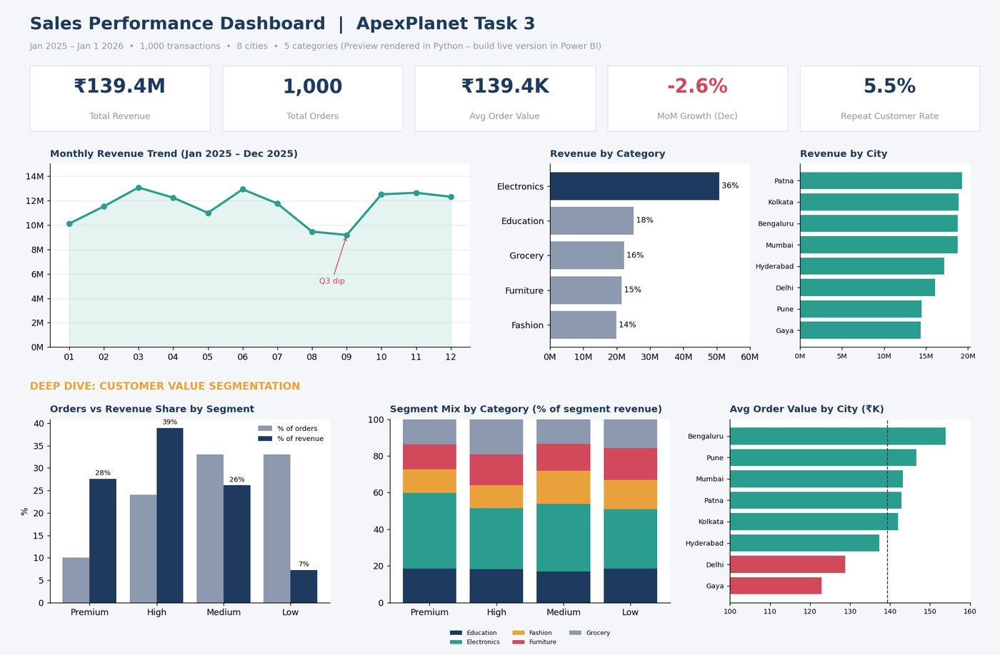
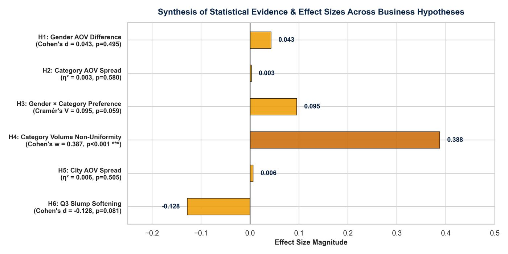

<p align="center"></p>

# Data Analyst Portfolio

**ApexPlanet Software Pvt. Ltd. Data Analytics Internship** | Mohammed Farshan | [GitHub: Farshan123](https://github.com/Farshan123)

This repository brings together the four projects I completed during my Data Analytics internship at ApexPlanet, from a raw sales file to statistically tested business recommendations. The code, data and full reports for each task live in their own repositories, linked below.

**Portfolio website:** _add the link here once GitHub Pages is live (expected format: `https://farshan123.github.io/Data-Analyst-Internship-Portfolio/`)_

## About me
I am a data analyst who completed the ApexPlanet Data Analytics Internship. My four projects used one retail dataset of 1,000 transactions across eight cities: I cleaned it, explored it with Python and SQL, defined KPIs and a dashboard design, and then tested six business hypotheses statistically. I try to say clearly what the data does and does not support.

<!-- TODO-EDUCATION: add one or two lines of education from your resume. -->

## Internship overview
| Task | Focus | Repository |
|---|---|---|
| 1 | Data cleaning and preprocessing | [Apexplanet-Task-1](https://github.com/Farshan123/Apexplanet-Task-1) |
| 2 | Exploratory data analysis and SQL | [Apexplanet-Task-2](https://github.com/Farshan123/Apexplanet-Task-2) |
| 3 | Deep-dive analysis and Power BI dashboard | [Apexplanet-Task-3](https://github.com/Farshan123/Apexplanet-Task-3) |
| 4 | Data storytelling and statistical validation | [Apexplanet-task-4](https://github.com/Farshan123/Apexplanet-task-4) |

Each task built on the one before: Task 1 produced clean data, Task 2 found patterns, Task 3 defined KPIs and segments, and Task 4 checked which patterns were statistically reliable.

## Project showcase
### Project 1: Data Cleaning and Preprocessing

<a href="https://github.com/Farshan123/Apexplanet-Task-1"></a>

*Chart generated from the project's own missing_values_report.csv (the repository has no dashboard screenshot for this task).*

- **Objective:** Inspect a raw sales dataset, measure its quality problems and produce a clean, reproducible file for the later tasks.
- **Tools:** Python, pandas, NumPy, CSV
- **Methodology:** Inspected shape, data types, summary statistics and unique values per column.
- **Important findings:**
  - Only two columns had missing values: Age (20 rows, 2.0%) and City (13 rows, 1.3%).
  - No exact duplicate rows were found, so all 1,000 rows were kept.
- **Skills demonstrated:** Data profiling and quality auditing, Missing-value and duplicate detection, Reproducible cleaning scripts (Python, pandas), Data validation
- **Repository:** [https://github.com/Farshan123/Apexplanet-Task-1](https://github.com/Farshan123/Apexplanet-Task-1)
- **Summary page:** [projects/task-1-data-cleaning.md](projects/task-1-data-cleaning.md)

### Project 2: Exploratory Data Analysis and SQL

<a href="https://github.com/Farshan123/Apexplanet-Task-2"></a>

*Static executive dashboard mock-up produced in Python for Task 2.*

- **Objective:** Explore the sales data end to end and answer core commercial questions: what sells, where, when and to whom.
- **Tools:** Python, pandas, Matplotlib, Seaborn, SQL (SQLite), Jupyter
- **Methodology:** Python cleaning, a SQLite database, seven SQL business queries, univariate and multivariate analysis, and a dashboard mock-up.
- **Important findings:**
  - Electronics led revenue with ₹50.78M, a 36.43% share.
  - Revenue peaked in March 2025 (₹13.06M) and softened in August and September (₹9.45M and ₹9.18M).
  - Bengaluru had the highest average order value at ₹153,881.76.
- **Skills demonstrated:** SQL aggregation, grouping and tiering, Exploratory data analysis, Data visualisation, Correlation analysis
- **Repository:** [https://github.com/Farshan123/Apexplanet-Task-2](https://github.com/Farshan123/Apexplanet-Task-2)
- **Summary page:** [projects/task-2-eda-sql.md](projects/task-2-eda-sql.md)

### Project 3: Deep-Dive Analysis and Power BI Dashboard

<a href="https://github.com/Farshan123/Apexplanet-Task-3"></a>

*Layout preview rendered in Python (as stated in the Task 3 README). The Power BI .pbix file is not part of the files used to build this site.*

- **Objective:** Answer which order-value segments, products, cities and age groups drive revenue and where the biggest growth opportunity lies.
- **Tools:** Power BI, DAX, Python, Excel
- **Methodology:** Defined five KPIs with formulas and rationale: Total Revenue, Total Orders, Average Order Value, Month-over-Month Growth and Repeat Customer Rate.
- **Important findings:**
  - 34% of orders (High and Premium tiers) generated 66.5% of revenue.
  - Electronics made up 36.4% of revenue and 41.4% of Premium-tier revenue.
  - Revenue in August and September ran about 16% below other quarters, then rebounded 36.2% in October.
- **Skills demonstrated:** KPI definition, Customer segmentation, DAX measure writing, Dashboard design and documentation
- **Repository:** [https://github.com/Farshan123/Apexplanet-Task-3](https://github.com/Farshan123/Apexplanet-Task-3)
- **Summary page:** [projects/task-3-power-bi.md](projects/task-3-power-bi.md)

### Project 4: Data Storytelling and Statistical Validation

<a href="https://github.com/Farshan123/Apexplanet-task-4"></a>

*Summary figure of the six hypothesis tests, exported from the Task 4 analysis.*

- **Objective:** Check whether patterns seen in Tasks 1 to 3 are statistically reliable, then turn the results into recommendations for decision makers.
- **Tools:** Python, SciPy, statsmodels, Jupyter, PowerPoint
- **Methodology:** Wrote six hypotheses with null and alternative statements and a 0.05 significance level.
- **Important findings:**
  - Only one of six hypotheses was rejected: order volume is not evenly spread across the five categories (chi-square = 150.13, p < 0.001).
  - No significant difference in average order value by gender (p = 0.495), category (p = 0.580) or city (p = 0.505).
  - Q3 order values were about ₹14,602 lower than other quarters, but this was not significant at the 0.05 level (p = 0.081).
- **Skills demonstrated:** Hypothesis testing, Assumption checking, Effect sizes and confidence intervals, Separating statistical from practical significance
- **Repository:** [https://github.com/Farshan123/Apexplanet-task-4](https://github.com/Farshan123/Apexplanet-task-4)
- **Summary page:** [projects/task-4-storytelling.md](projects/task-4-storytelling.md)

## Technical skills
Only skills used in the four projects are listed.

| Category | Skills used |
|---|---|
| Programming | Python (pandas, NumPy, Matplotlib, Seaborn, SciPy, statsmodels) |
| Data analysis | Data cleaning, exploratory data analysis, feature engineering, segmentation |
| Database and SQL | SQL on SQLite: aggregation, grouping, ranking, tiering |
| Data visualisation | Matplotlib and Seaborn charts, dashboard mock-ups |
| Business intelligence | Power BI dashboard design, KPI definition, DAX measures |
| Statistical analysis | Welch's t-test, one-way ANOVA, chi-square tests, confidence intervals, effect sizes, assumption checks |
| Development tools | Git and GitHub, Jupyter notebooks, Excel (source data), PowerPoint |

More detail with examples: [reports/technical-skills.md](reports/technical-skills.md).

## Learning outcomes
- Clean data is a project in itself: documenting missing values and key collisions early saved effort in every later task.
- Charts suggest, tests decide: in Task 4, five of six hypotheses, including city and category differences that looked meaningful on dashboards, were not statistically significant.
- Statistical significance is not business significance, and both belong in a recommendation.
- Documenting data caveats (repeated Order_IDs, missing City and Age, a partial final month) makes results more trustworthy.

Full reflection: [reports/learning-reflections.md](reports/learning-reflections.md) | Summary: [reports/internship-summary.md](reports/internship-summary.md)

## Contact
- GitHub: [github.com/Farshan123](https://github.com/Farshan123)
- Email and LinkedIn: _to be added by the owner_

## Repository structure
```
README.md             this file
projects/             one summary page per task
reports/              internship summary, skills, reflections, review checklist, launch kit
docs/                 the portfolio website (published with GitHub Pages)
assets/               banner and image folders
PUBLISHING_GUIDE.md   how to upload this repository and turn on GitHub Pages
```

## Run the website locally
Open `docs/index.html` in any browser. No installation is needed.

## Licence
MIT. See [LICENSE](LICENSE).
