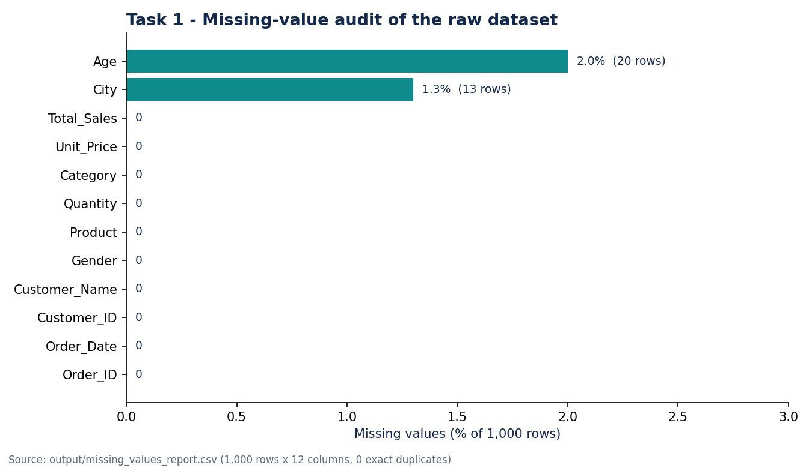

# Task 1: Data Cleaning and Preprocessing

**Internship:** ApexPlanet Software Pvt. Ltd. Data Analytics Internship
**Repository:** [Farshan123/Apexplanet-Task-1](https://github.com/Farshan123/Apexplanet-Task-1)
**Tools:** Python, pandas, NumPy, CSV

*Chart generated from the project's own missing_values_report.csv (the repository has no dashboard screenshot for this task).*

## Objective
Inspect a raw sales dataset, measure its quality problems and produce a clean, reproducible file for the later tasks.

## Dataset
1,000 rows and 12 columns: Order_ID, Order_Date, Customer_ID, Customer_Name, Age, Gender, City, Product, Category, Quantity, Unit_Price, Total_Sales.

## Methodology
1. Inspected shape, data types, summary statistics and unique values per column.
2. Wrote a missing-value report (count and percentage per column).
3. Checked for exact duplicate rows.
4. Standardised column names to lowercase snake_case, converted blank cells to missing values and trimmed whitespace in text columns.
5. Removed exact duplicates (if any) and validated the row count before and after.

## Analysis performed
Data-quality audit and cleaning only; no modelling at this stage.

## Important findings
- Only two columns had missing values: Age (20 rows, 2.0%) and City (13 rows, 1.3%).
- No exact duplicate rows were found, so all 1,000 rows were kept.

## Project outputs
- cleaned_dataset.csv
- missing_values_report.csv
- data_dictionary.csv
- task1_cleaning.py (cleaning script)

## Skills demonstrated
- Data profiling and quality auditing
- Missing-value and duplicate detection
- Reproducible cleaning scripts (Python, pandas)
- Data validation

## Source
All details on this page are taken from the [Task 1 repository](https://github.com/Farshan123/Apexplanet-Task-1). Open the repository for the full code, data and reports.
