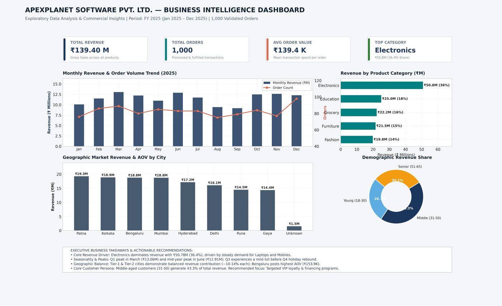

# Task 2: Exploratory Data Analysis and SQL

**Internship:** ApexPlanet Software Pvt. Ltd. Data Analytics Internship
**Repository:** [Farshan123/Apexplanet-Task-2](https://github.com/Farshan123/Apexplanet-Task-2)
**Tools:** Python, pandas, Matplotlib, Seaborn, SQL (SQLite), Jupyter

*Static executive dashboard mock-up produced in Python for Task 2.*

## Objective
Explore the sales data end to end and answer core commercial questions: what sells, where, when and to whom.

## Dataset
1,000 transactions from 1 January 2025 to 1 January 2026 across 8 cities, 5 categories and 6 products.

## Methodology
1. Cleaned the data in Python: median-imputed 20 missing ages (with an audit flag), labelled 13 missing cities as Unknown, kept 9 colliding ORD100050 records by giving them unique suffixes and confirmed Total_Sales = Quantity x Unit_Price on every row.
2. Added date and age-group features.
3. Staged the data in a SQLite database and ran seven business queries.
4. Ran univariate and multivariate analysis, including a correlation heatmap.
5. Built a static dashboard mock-up.

## Analysis performed
Category, monthly, city, demographic, top-customer, product and order-size-tier analysis in SQL, plus correlation analysis in Python.

## Important findings
- Electronics led revenue with ₹50.78M, a 36.43% share.
- Revenue peaked in March 2025 (₹13.06M) and softened in August and September (₹9.45M and ₹9.18M).
- Bengaluru had the highest average order value at ₹153,881.76.
- Orders of ₹250k or more were 17.0% of orders but 41.62% of revenue.
- Total_Sales correlated with Unit_Price (r = 0.697) and Quantity (r = 0.638).

## Project outputs
- Jupyter EDA notebook
- business_queries.sql with 7 queries and exported result tables
- 8 exported figures
- EDA report and dashboard mock-up

## Skills demonstrated
- SQL aggregation, grouping and tiering
- Exploratory data analysis
- Data visualisation
- Correlation analysis
- Business-insight writing

## Source
All details on this page are taken from the [Task 2 repository](https://github.com/Farshan123/Apexplanet-Task-2). Open the repository for the full code, data and reports.
