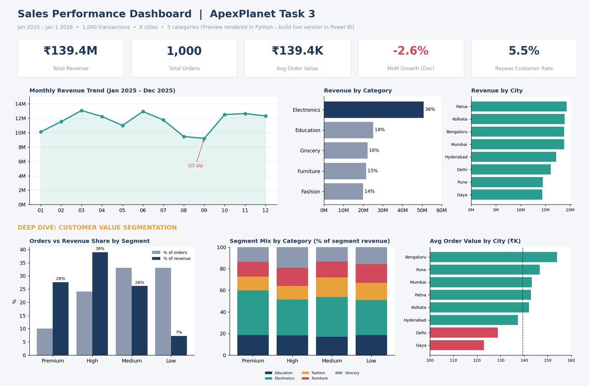

# Task 3: Deep-Dive Analysis and Power BI Dashboard

**Internship:** ApexPlanet Software Pvt. Ltd. Data Analytics Internship
**Repository:** [Farshan123/Apexplanet-Task-3](https://github.com/Farshan123/Apexplanet-Task-3)
**Tools:** Power BI, DAX, Python, Excel

*Layout preview rendered in Python (as stated in the Task 3 README). The Power BI .pbix file is not part of the files used to build this site.*

## Objective
Answer which order-value segments, products, cities and age groups drive revenue and where the biggest growth opportunity lies.

## Dataset
The cleaned 1,000-transaction sales dataset, enriched with value segment, age group, month and data-quality flags.

## Methodology
1. Defined five KPIs with formulas and rationale: Total Revenue, Total Orders, Average Order Value, Month-over-Month Growth and Repeat Customer Rate.
2. Segmented orders into Low, Medium, High and Premium tiers using percentile thresholds on order value.
3. Wrote DAX measures for the KPIs and the segmentation analysis.
4. Documented the dashboard build (theme file and step-by-step guide).

## Analysis performed
Value-segment, category, city and month analysis, with data caveats documented (repeated Order_ID, missing City and Age, a partial final month).

## Important findings
- 34% of orders (High and Premium tiers) generated 66.5% of revenue.
- Electronics made up 36.4% of revenue and 41.4% of Premium-tier revenue.
- Revenue in August and September ran about 16% below other quarters, then rebounded 36.2% in October.
- 94.5% of customers bought only once; the repeat rate was 5.5%.

## Project outputs
- KPI definitions
- Deep-dive analysis and key-findings reports
- DAX measures file and Power BI theme
- Dashboard build guide and preview images

## Skills demonstrated
- KPI definition
- Customer segmentation
- DAX measure writing
- Dashboard design and documentation
- Data-caveat documentation

## Source
All details on this page are taken from the [Task 3 repository](https://github.com/Farshan123/Apexplanet-Task-3). Open the repository for the full code, data and reports.
