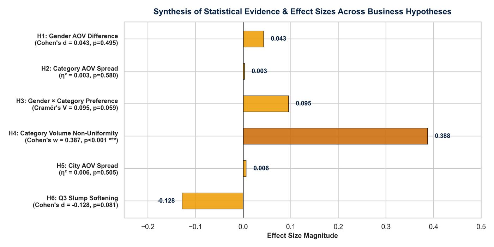

# Task 4: Data Storytelling and Statistical Validation

**Internship:** ApexPlanet Software Pvt. Ltd. Data Analytics Internship
**Repository:** [Farshan123/Apexplanet-task-4](https://github.com/Farshan123/Apexplanet-task-4)
**Tools:** Python, SciPy, statsmodels, Jupyter, PowerPoint

*Summary figure of the six hypothesis tests, exported from the Task 4 analysis.*

## Objective
Check whether patterns seen in Tasks 1 to 3 are statistically reliable, then turn the results into recommendations for decision makers.

## Dataset
The same 1,000-transaction sales dataset (987 to 1,000 rows used per test, depending on missing values).

## Methodology
1. Wrote six hypotheses with null and alternative statements and a 0.05 significance level.
2. Chose Welch's t-test, one-way ANOVA, chi-square independence and chi-square goodness-of-fit tests.
3. Checked assumptions (Levene's test for equal variances, expected cell counts for chi-square).
4. Reported test statistics, exact p-values, 95% confidence intervals and effect sizes, and separated statistical from practical significance.
5. Built a 17-slide presentation and an automated test suite for the statistical code.

## Analysis performed
Gender, category, city and quarter comparisons of order value and order volume.

## Important findings
- Only one of six hypotheses was rejected: order volume is not evenly spread across the five categories (chi-square = 150.13, p < 0.001).
- No significant difference in average order value by gender (p = 0.495), category (p = 0.580) or city (p = 0.505).
- Q3 order values were about ₹14,602 lower than other quarters, but this was not significant at the 0.05 level (p = 0.081).
- The gender and category association was borderline and not significant (p = 0.059).

## Project outputs
- Hypothesis-testing notebook
- statistical_results.csv
- 17-slide PowerPoint and slide images
- Hypothesis-testing and data-storytelling reports
- Python modules and unit tests

## Skills demonstrated
- Hypothesis testing
- Assumption checking
- Effect sizes and confidence intervals
- Separating statistical from practical significance
- Executive presentation and storytelling

## Source
All details on this page are taken from the [Task 4 repository](https://github.com/Farshan123/Apexplanet-task-4). Open the repository for the full code, data and reports.
